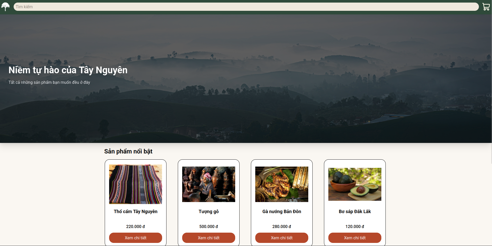
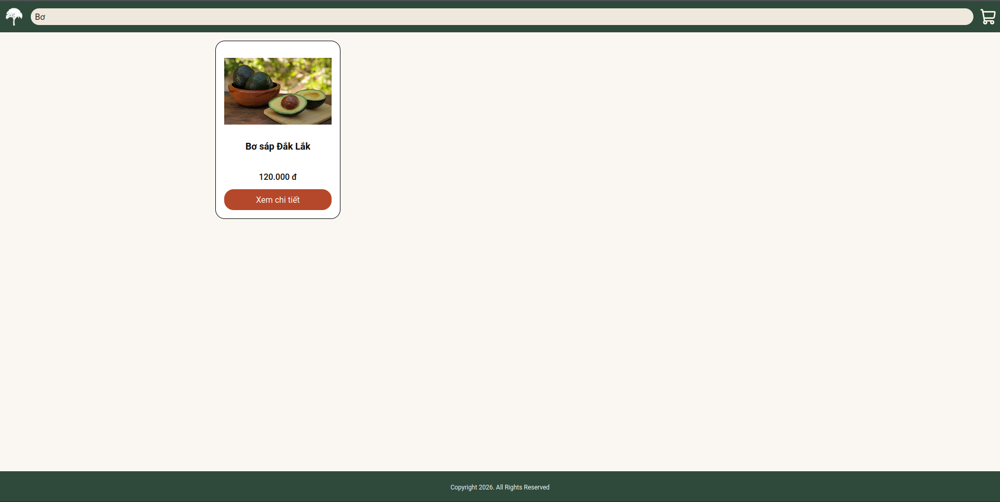
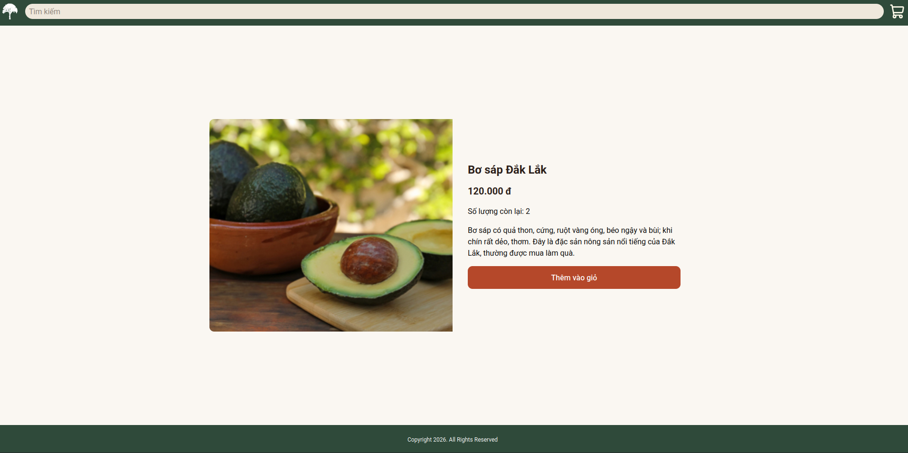
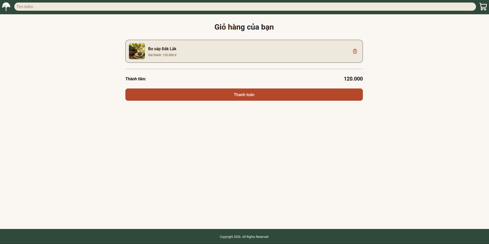
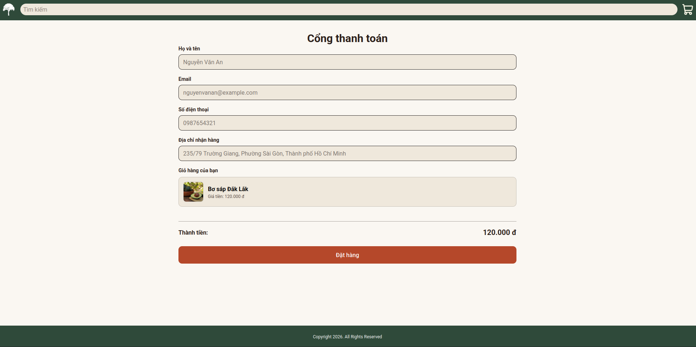

# Dự án Highland-Vendor
## Tổng quan
Highland-Vendor là một web e-commerce chuyên bán đặc sản của Tây Nguyên như đồ thủ công và món ăn, tập trung vào phần mua hàng cốt lõi.

[Bấm vào đây để truy cập vào website](highland-vendor.vercel.app)

## Video Demo

[Bấm vào đây để  xem video](https://1drv.ms/v/c/45D6AD3AA5C3439C/IQCzXYp5iTH8RKDKgPyHUnRCAfc0Knu8wMnQ4foTHD1TqXg)
## Ảnh

<figure>
    
    <figcaption style="text-align:center">Trang chủ</figcaption>
 </figure>

 <figure>
    
    <figcaption style="text-align:center">Kết quả tìm kiếm</figcaption>
 </figure>

 <figure>
    
    <figcaption style="text-align:center">Chi tiết sản phẩm</figcaption>
 </figure>

 <figure>
    
    <figcaption style="text-align:center">Giỏ hàng</figcaption>
 </figure>

 <figure>
    
    <figcaption style="text-align:center">Thanh toán</figcaption>
 </figure>


## Thư viện sử dụng
- React 
- Typescript
- Vite
- Tailwind CSS
- React Router
- Zustand
- Lucide Icon
- Shadcn/ui
- Vitest
- React Testing Library
- Supabase 

## Kiến trúc dự án
```markdown tree
src
|_assets
|_components
|    |_card.tsx
|    |_footer.tsx
|    |_header.tsx
|    |_slideshow.tsx
|_pages
|    |_Cart.tsx
|    |_Checkout.tsx
|    |_Home.tsx
|    |_ProductDetails.tsx
|    |_SearchResult.tsx
|_store
|    |_useCartStore.ts
|_tests
|    |_cart.test.tsx
|    |_checkout.test.tsx
|    |_home.test.tsx
|    |_productDetails.test.tsx
|    |_search.test.tsx
|_utils
|    |_supabase.ts
|_index.css
|_main.tsx
```

## Hướng dẫn cài đặt
Lưu ý: Vì dự án này sử dụng Supabase nên sẽ không có dữ liệu khi mở lên. Nếu muốn có dữ liệu hãy tham khảo [tài liệu của Supabase](https://supabase.com/docs/guides/getting-started/quickstarts/reactjs) và file .env.example. Phần hướng dẫn này chỉ đề cập đến phần Frontend.

**Bước 1: Clone dự án**
```bash
git clone git@github.com:giaphuc060405/Highland-Vendor.git
```
hoặc 
```bash
git clone https://github.com/giaphuc060405/Highland-Vendor.git
```

**Bước 2: Mở project và cài đặt thư viên phụ thuộc** 
```bash
npm i
```
hoặc
```bash
npm install
```

**Bước 3: Khởi động dự án** 
```bash
npm run dev 
```
Dự án sẽ chạy qua địa chỉ: http://localhost:5173/

## Các lệnh chạy test

Nếu muốn chạy toàn bộ test
```bash
npm run test
```

Nếu chỉ muốn chạy một test
```bash
npm run test src/tests/[tên file]
```
Ví dụ với test trang Home
```bash
npm run test src/tests/home.test.tsx
```


